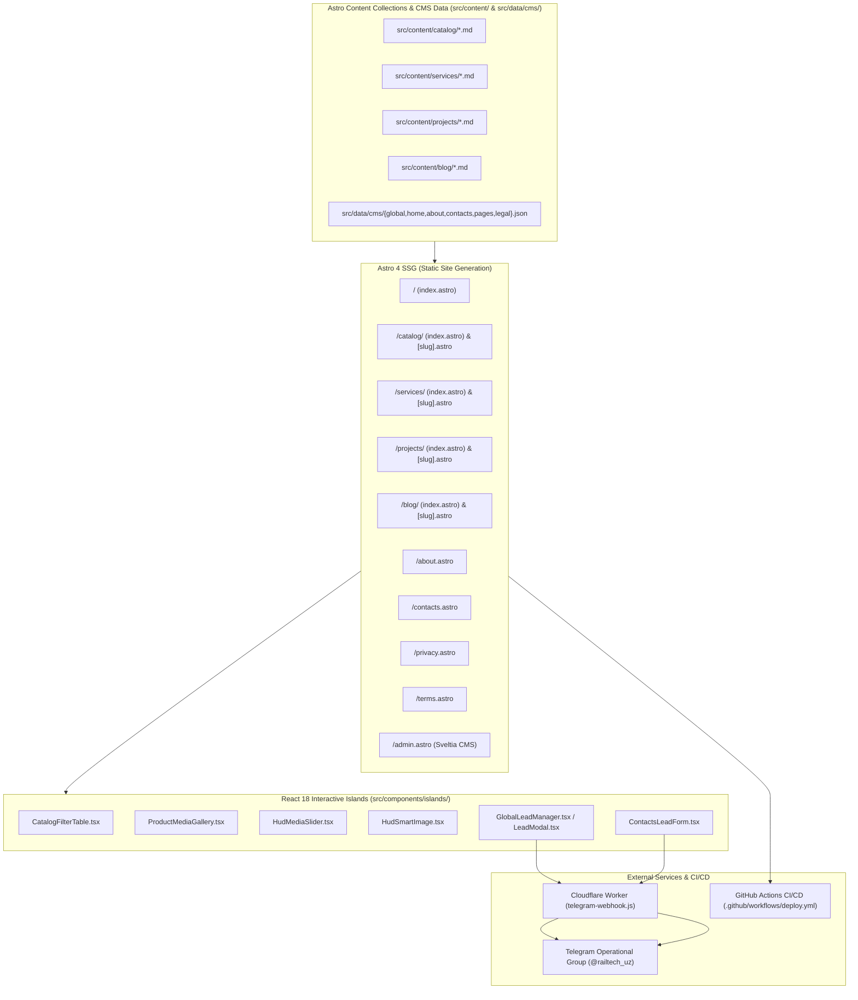

# System Architecture — RailTech B2B/B2G Portal

## 1. Architectural Overview



## 2. Directory Layout

```
rt-corporate-website/
├── .github/workflows/deploy.yml   # GitHub Pages deployment pipeline
├── cloudflare-worker/             # Cloudflare worker for Telegram lead webhook
├── docs/                          # Architecture & domain documentation
├── public/
│   ├── admin/                     # Sveltia CMS config.yml and index.html
│   ├── images/                    # Product photos, factory blueprints, art assets
│   └── robots.txt, sitemap.xml    # SEO & domain routing
├── src/
│   ├── components/
│   │   ├── Header.astro           # Swiss CAD header with dynamic navigation from CMS
│   │   ├── Footer.astro           # Institutional legal dossier, GPS & logistics details from CMS
│   │   ├── I18nText.astro         # Trilingual CAD switcher component (RU / UZ / EN)
│   │   ├── hud/                   # Brutalist HUD frame components
│   │   └── islands/               # React 18 interactive client islands
│   ├── content/                   # Typed Markdown content collections (catalog, services, projects, blog)
│   ├── data/cms/                  # CMS JSON storage (global, home, about, contacts, pages, legal)
│   ├── layouts/BaseLayout.astro   # Root HTML document, meta tags, Schema.org rich graph
│   ├── pages/                     # Multi-page physical URLs + dynamic datasheets
│   └── styles/global.css          # Tailwind CSS & CAD utilities
├── AGENTS.md                      # AI agent primary instructions
└── astro.config.mjs               # Astro configuration (@astrojs/react, @astrojs/sitemap)
```

## 3. Client Hydration Strategy
* `client:load`: Used for components that need immediate event binding (`GlobalLeadManager`, `CatalogFilterTable`, `ProductMediaGallery`, `HudMediaSlider`).
* `client:visible`: Used for below-the-fold interactive components (`ContactsLeadForm`).
* Pure static Astro components: All static layout elements (`Header.astro`, `Footer.astro`, article bodies, passport tables, legal text) are rendered strictly to zero-JS HTML with full Markdown formatting for all 3 languages.
