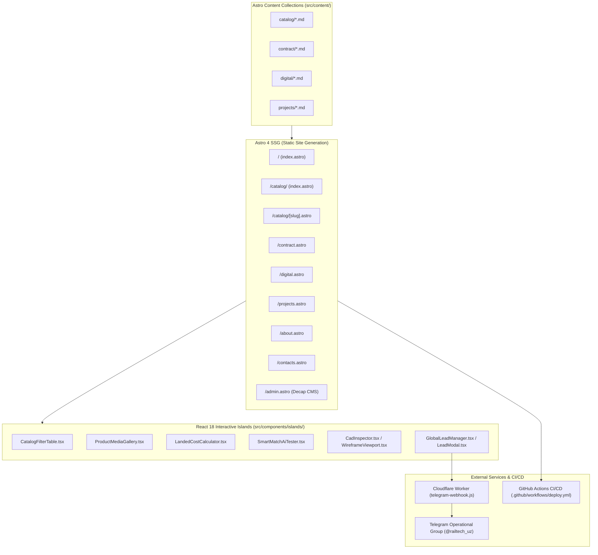

# System Architecture — RailTech B2B/B2G Portal

## 1. Architectural Overview



## 2. Directory Layout

```
railtech-v2/
├── .github/workflows/deploy.yml   # GitHub Pages deployment pipeline
├── cloudflare-worker/             # Cloudflare worker for Telegram lead webhook
├── docs/                          # Architecture & domain documentation
├── public/
│   ├── admin/                     # Decap CMS config.yml and index.html
│   ├── images/                    # Product photos, factory blueprints, art assets
│   ├── models/                    # 3D .glb models (bogie.glb, container.glb)
│   └── robots.txt, CNAME          # SEO & domain routing
├── skills/                        # AI Agent specialized skills
├── src/
│   ├── components/
│   │   ├── Header.astro           # Swiss CAD header with active state highlighting
│   │   ├── Footer.astro           # Institutional legal dossier & logistics details
│   │   └── islands/               # React 18 interactive client islands
│   ├── content/                   # Typed Markdown content collections
│   ├── layouts/BaseLayout.astro   # Root HTML document, meta tags, Schema.org
│   ├── pages/                     # 8 physical URLs + dynamic product datasheets
│   └── styles/global.css          # Tailwind CSS & CAD utilities
├── AGENTS.md                      # AI agent primary instructions
├── CLAUDE.md                      # Claude Code instructions
├── .cursorrules                   # Cursor / Windsurf IDE rules
└── astro.config.mjs               # Astro configuration (@astrojs/react, @astrojs/sitemap)
```

## 3. Client Hydration Strategy
* `client:load`: Used for components that need immediate event binding (`GlobalLeadManager`, `CatalogFilterTable`, `ProductMediaGallery`).
* `client:visible`: Used for below-the-fold interactive components (`LandedCostCalculator`, `SmartMatchAiTester`, `CadInspector`).
* Pure static Astro components: All static layout elements (`Header.astro`, `Footer.astro`, article bodies, passport tables) are rendered strictly to zero-JS HTML.
